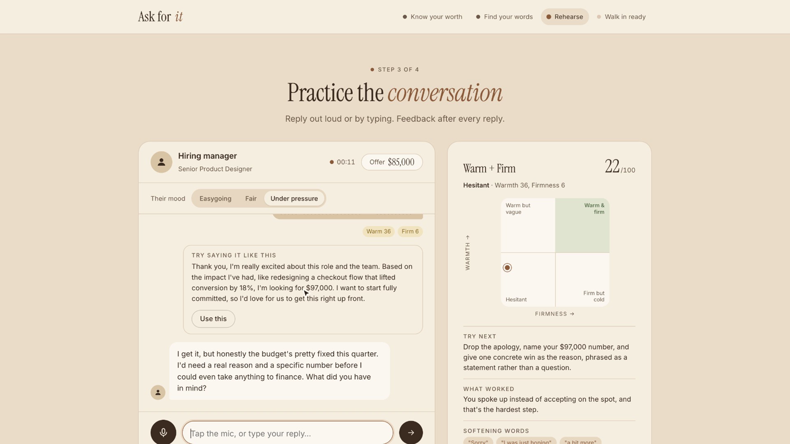
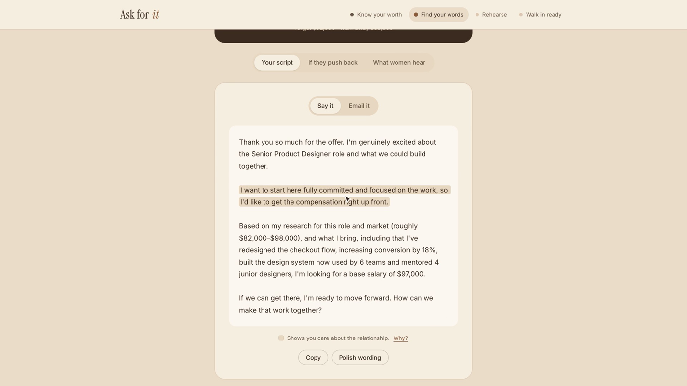

# Ask For It

A salary-negotiation practice app for women. You rehearse the conversation with an AI hiring manager who reacts the way a real one might, and after every reply you get coaching on how warm, how firm, and how hesitant you sounded.

Built at the Anthropic Hackathon (November 2026).



**Demo video (3:34):** [demo/FINALDEMO.mp4](demo/FINALDEMO.mp4)

## Why

Women are less likely to negotiate pay, and are often judged more harshly when they do. Most advice stops at "just negotiate." Ask For It lets you practice until asking feels normal, before the real conversation.

## How it works

1. **Know your worth.** Enter your offer or current salary and see how a small raise compounds over a career.
2. **Find your words.** Get a suggested counter and walk-away number, turn rough notes into clear wins, and get a word-for-word script.
3. **Rehearse.** Talk to an AI hiring manager (easygoing, fair, or under pressure) by typing or speaking. Each reply is scored on warmth and firmness, softening words like "sorry" and "just" are flagged, and you get a stronger rewrite.
4. **Walk in ready.** Finish with a recap of your practice and a game plan with your key numbers and answers if they push back.



## Design choices

- **Your numbers stay with you.** Salary details stay in the browser, and the API key stays on the server.
- **Warm and firm, not just aggressive.** Coaching follows Hannah Riley Bowles' research on how women can negotiate without social backlash.
- **No invented facts.** The wins helper is told to use only the numbers and results you give it.
- **Works under pressure.** If the AI call fails, practice switches to a scripted offline manager.

## Tech stack

- Node.js and Express server
- Anthropic API (Claude) with structured JSON output for the manager reply and the coaching scores
- Plain HTML, CSS, and JavaScript front end
- Browser speech recognition for spoken replies
- Per-IP rate limiting to protect API credits

## Run it locally

```bash
git clone https://github.com/DheekshaBaskaran/Ask-for-it.git
cd Ask-for-it
npm install
cp .env.example .env   # add your ANTHROPIC_API_KEY
npm start              # http://localhost:3000
```

Without an API key, the app still runs in scripted mode.
